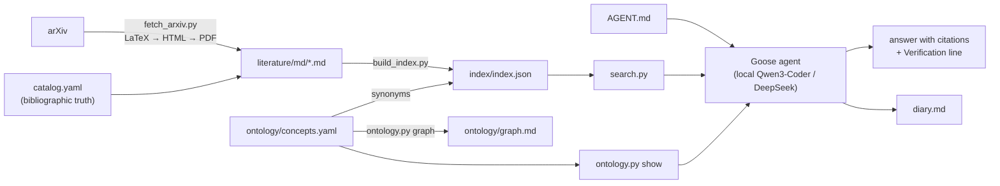

# Environment and context: a personal agent environment for gravitational waves from core-collapse supernovae

**Course:** AI Assistants for Researchers (AI4Science), Yandex School of Data Analysis, autumn 2026
**Assignment:** Environment and context (weeks 1–5)
**Author:** Sultan Abylkairov, Nazarbayev University
**Repository:** <!-- FILL: GitHub link -->

## Summary

I built a working environment in which the course agent (`ai4science`) answers
questions about my research field — gravitational waves (GWs) from core-collapse
supernovae (CCSNe) and machine learning (ML) — from my own library, not from model
memory. It has the four required parts:

1. **Contract** `AGENT.md` (Appendix A): goal, data, tools, citation and verification
   rules, journal format, forbidden actions and a definition of done.
2. **Ontology and concept graph**: 41 concepts in four groups with 49 typed relations;
   validated automatically and rendered as a Mermaid graph.
3. **Search over a personal library**: 43 papers (my 12 arXiv papers and 31 key external
   papers, including Richers et al. 2017) converted from arXiv to Markdown, searched by
   BM25 with ontology synonyms. Every hit is cited by file, line range and section.
4. **Work journal** `diary.md`, append-only, written by me and by the agent.

Section 8 gives the example queries to the local context, with expected answers checked
against the papers, an automatic retrieval check and agent transcripts for two models.

## 1. Goal and scope

My research uses ML to extract physics from simulated CCSN GW signals: classifying the
nuclear equation of state (EOS), estimating rotation and the peak frequency f_peak, and
finding how far current and future detectors can do this. An assistant is useful here
only if its statements can be traced to a paper: the field is full of numbers whose
meaning depends on conditions (detector, distance, orientation, SNR, EOS set), and the
published literature itself contains citation errors. The environment is therefore
built around one principle: **no claim without a checkable source**.

Scope of the library: my own papers, the waveform catalog paper my work builds on
(Richers et al. 2017), reviews, detector science cases, and the main ML and inference
papers on CCSN GWs (`literature/catalog.yaml`).

## 2. Architecture



The agent is Goose, the engine of the course's AI4Science agent, with Goose's shell and
file tools. Because the course key allows 3M tokens a day, I run the same agent on three
model backends, changing only the model (`src/agent.py`):

| Backend | Model | Role in the experiment |
|---|---|---|
| Local (vLLM) | Qwen3-Coder-30B-A3B-Instruct, FP8 — an open-weight MoE model (30.5B total, 3.3B active parameters) tuned for tool use | debugging the workflow without a token limit |
| DeepSeek API | `deepseek-flash` | final runs |
| Course (`ai4science`) | Yandex AI Studio models | reference |

`src/agent.py` reuses the Goose binary and the course instructions from the AI4Science
installation and adds `AGENT.md` to the system prompt, so every model receives the same
contract. A small local proxy (`src/llm_proxy.py`) adds the API key, switches DeepSeek's
thinking mode off (with thinking on, DeepSeek rejects tool-using turns unless the client
resends the model's reasoning), and logs token usage for each run. The library tools are
plain command-line scripts, so they behave the same for every model.

## 3. The contract (`AGENT.md`)

The full text is in Appendix A. It follows the structure of the course example (goal,
data, how to work, journal, forbidden) and adds what a literature-based project needs:

| Rule | Why | How it is supported |
|---|---|---|
| Search the library before answering; never fill gaps from memory | Model memory of papers is unreliable | `search.py`; the agent must answer "Not found in the local library (searched: …)" |
| Cite each claim as `literature/md/<key>.md:Lstart-Lend § section` | A citation should be checkable in seconds | `search.py` prints exactly this string; `sed -n` shows the passage |
| Read the passage before citing; cite only passages returned in this session | Prevents citing a plausible but wrong paragraph | Line ranges in every hit |
| Quote numbers exactly, with units and conditions | Detection distances and accuracies are meaningless without conditions | `--exact` search for numbers |
| Bibliographic details only from `catalog.yaml` | Reference lists in published papers contain errors (Section 5) | Catalog checked against arXiv with `fetch_arxiv.py --check` |
| Every conclusion ends with a Verification line | Course requirement: a way to re-check independently | Examples of verification commands in §5 of the contract |
| Append a journal entry after each task | Traceability of the work | Entry format in §6; `diary.md` is append-only |
| Work in English | The course agent's default language is Russian; this project is in English | Stated in §1 of the contract |
| Raw data and converted papers are read-only | Reproducibility | Papers are regenerated only by `fetch_arxiv.py` |

## 4. Personal library

**Content.** `literature/catalog.yaml` has 45 entries, 43 of them active: 12 papers
co-authored by me and 31 external papers. Two more are listed as optional. Each entry
records the arXiv ID, a short author string, year, venue, DOI, whether it is my paper,
whether it is active, its verification status and a one-line topic note. Full titles
and author lists are written into each Markdown file's front matter from the arXiv API.

**Conversion** (`src/fetch_arxiv.py`). For physics papers the LaTeX source is the best
input, because equations survive as LaTeX:

1. arXiv LaTeX source → pandoc → GitHub Markdown (`$...$` math). The script handles both
   forms arXiv serves (a gzipped tar for multi-file submissions, a gzipped single `.tex`
   file otherwise), extracts tar files safely, finds the main file, runs pandoc inside the
   source tree so `\input` works, and keeps the title and abstract.
2. arXiv HTML → pandoc, if the LaTeX route fails (custom macros).
3. PDF → Marker or MinerU if installed, otherwise pypdf with one section per page.

Requests to arXiv are spaced by at least 3 s. Papers that cannot be downloaded
automatically can be converted from a file saved in a browser (`--local`).

**Library statistics** (from `python3 src/search.py --papers` and the front matter):

| | Count |
|---|---|
| Papers indexed | 43 / 43 |

**Licensing.** Most arXiv papers carry arXiv's non-exclusive licence, which does not
allow redistribution. The repository therefore commits only my own converted papers;
everything else is rebuilt with `make fetch`.

## 5. Bibliographic verification

All 12 of my papers and the external papers were checked against their arXiv records
(and ADS where needed). Entries whose journal details could not be confirmed are marked
`verified: partial` (four entries, e.g. the autoencoder paper 2306.14194 has no journal
reference on arXiv). `python3 src/fetch_arxiv.py --check` repeats the comparison against
the arXiv API at any time.

The check was worth doing: a recent preprint in the library (Mitra 2026, arXiv:2607.06736)
lists wrong author names for Richers et al. 2017 and for one of my papers. This is why the
contract forbids copying references from other papers' reference lists.

## 6. Ontology and concept graph

`ontology/concepts.yaml` defines 41 concepts in four groups — stellar-collapse physics (11),
GW signal (9), detectors and data (9), ML and inference (12) — with 49 directed relations
of six types:

| Relation | Meaning | Count |
|---|---|---|
| `is_a` | subclass or instance of | 13 |
| `part_of` | component or phase of | 7 |
| `depends_on` | physically or statistically varies with | 15 |
| `estimates` | ML task infers this quantity | 5 |
| `uses` | method relies on this data or technique | 5 |
| `related_to` | weak association | 4 |

Every concept has a definition, synonyms and source papers from the catalog. For
example, *bounce signal* `depends_on` *rotation ratio T/|W|* and *differential rotation*;
*f_peak* is `part_of` the *ring-down* and `depends_on` the *dynamical frequency* and
*T/|W|*; *EOS classification* `estimates` the *EOS* and `uses` the *waveform catalog*.

The ontology is used in three ways:
- **Query expansion.** A query that mentions a concept also matches its synonyms
  ("beta" finds passages that write T/|W|, "LOEO" finds "leave-one-EOS-out").
- **Concept look-up by the agent.** `python3 src/ontology.py show <term>` prints the
  definition, relations in both directions and source papers.
- **Checks.** `ontology.py validate` rejects undefined relation targets, unknown source
  keys and missing definitions; the self-test checks that the graph is up to date.

The full graph is in [`ontology/graph.md`](ontology/graph.md) (rendered by GitHub).

## 7. Search

- **Chunks.** Each paper is split into chunks of whole paragraphs (about 180 words)
  within one section. A chunk keeps its heading path and its line range in the file.
- **Notation.** Physics notation is normalised before indexing: `T/|W|`, `$T/|W|$` and
  `T/W` become one token, as do `f_\mathrm{peak}`, `f_{peak}` and `f_peak`.
- **Ranking.** Okapi BM25 (k1 = 1.2, b = 0.75); synonyms from the ontology get weight 0.4.
- **Filters.** `--own` (my papers only), `--file <key>`, `--exact "<string>"` for numbers
  and EOS names, `--json` for programs.
- **Output.** Each hit prints `literature/md/<key>.md:Lstart-Lend § section` and the
  best-matching sentence.

Why lexical search rather than embeddings: the questions in this field turn on exact
numbers, EOS names (SFHo, LS220) and symbols, which BM25 matches exactly; the library is
small; and the search runs anywhere with the standard library, without a GPU or an API.

## 8. Examples of queries to the local context

### 8.1 Direct use of the tools

```text
$ python3 src/ontology.py show beta
Rotation ratio T/|W|  [rotation_ratio, group: physics]
  Definition: Ratio of rotational kinetic energy T to gravitational binding energy |W| of the inner core (at bounce in Richers et al. 2017).
  Synonyms:   T/|W|, T/W, beta, rotational energy ratio, kinetic to gravitational energy ratio
  -> is_a       Core rotation [rotation]
  <- depends_on Bounce signal [bounce_signal]
  <- depends_on Bounce amplitude [bounce_amplitude]
  <- depends_on Peak frequency f_peak [f_peak]
  <- estimates  Parameter estimation [parameter_estimation]
  Sources:
    richers2017: Richers, Ott, Abdikamalov, O'Connor, Sullivan (2017), Phys. Rev. D 95, 063019  -> literature/md/richers2017.md
    abdikamalov2014: Abdikamalov, Gossan, DeMaio, Ott (2014), Phys. Rev. D 90, 044001  -> literature/md/abdikamalov2014.md

$ python3 src/search.py "peak frequency f_peak equation of state" -k 3
[1] 22.28  literature/md/afle2021.md:L236-L242 § Inferring physical properties of stellar collapse by third-generation gravitational-wave detectors > III Mapping to physical parameters
    Richers <span id="S3.p6.1.1" class="ltx_text ltx_font_italic">et al.</span> observed that for simulations with $0.02\leq\beta\leq 0.06$, $f_{\mathrm{peak}}$ for a given nuclear equation of state is independent of the value of $\beta$ (see Fig.

[2] 17.20  literature/md/richers2017.md:L20-L20 § Equation of State Effects on Gravitational Waves from Rotating Core Collapse > Abstract
    Since these GWs are emitted from the quadrupole-deformed nuclear-density core, they may encode information on the uncertain nuclear equation of state (EOS).

[3] 16.91  literature/md/mezzacappa_zanolin2024.md:L287-L295 § Predictions of Core Collapse Supernova Gravitational Wave Emission from Multi-Physics Simulations > Culling Information about the Proto-Neutron Star through a Gravitational Wave Detection
    It is well known from asteroseismology that the peak frequency of $g$-modes depend on the gravity at the source – i.e., $$\begin{equation} f_{\rm peak}\sim \frac{GM}{R^2}, \label{eq:gmodepeak} \end{equation}$$ where $G$ is Newton’s gravitational constant, $M$ is the enclosed mass, and $R$ is the radius, at which the ...

```

### 8.2 Questions to the agent, with expected answers

The expected answers were checked against the papers; they are stored with the search
used for the retrieval check in `eval/queries.yaml`.

| # | Question | Expected answer (gist) | Source |
|---|---|---|---|
| q1 | According to Richers et al. 2017, how does the bounce-signal amplitude depend on T/\|W\|? | Roughly linear at slow rotation with similar slopes for all EOS: fits for T/\|W\| ≤ 0.04 give slopes of about 237–315 × 10⁻²¹ at 10 kpc; departs from linear near T/\|W\| ≈ 0.06–0.09 depending on the differential rotation A | richers2017, Table IV |
| q2 | What is f_peak and how does it depend on the EOS? | Peak of the early post-bounce spectrum, about 600–1000 Hz; slow-rotation means from 669 Hz (HSNL3) to 772 Hz (SFHo); the EOS enters through √(Gρ̄_c), with a universal relation and a kink near T/\|W\| ≈ 0.06 | richers2017, Table VI, Fig. 9 |
| q3 | Which of my papers use SHAP or other explainable-AI methods? | **None** (negative test): SHAP appears only in Mitra 2026 and in the SHAP method paper | `--own` search is empty |
| q4 | Out to what distance can LIGO A+, ET and CE classify the EOS? | Optimal orientation, accuracy ≳ 70%: ~20 kpc (A+), ~80 kpc (ET), ~100 kpc (CE); approximate upper limits | abylkairov2025_distance |
| q5 | Does adding detectors to a network improve EOS classification? | Mainly more uniform sky coverage: normalised AUC 0.67 (HL) → 0.76 (HLVKA); sky fraction above 0.7 accuracy 0.69 → 0.93; ET+CE40 ~100 kpc | akhmetali2026_networkeos |
| q6 | Does bounce-time uncertainty hurt classification or parameter estimation? | No significant effect up to 20 ms on EOS classification; parameter estimation in the Fourier domain is robust; near pole-on orientations do hurt | akhmetali2026_realistic, akhmetali2026_pehorizon |
| q7 | Can the iron-core mass be inferred from the bounce signal? | Accuracy does not exceed ~70% for four masses; entropy features reach ~77% at SNR 200 | mitra2023_ironcore, sakan2025_entropy |
| q8 | Is random cross-validation enough to claim EOS inference? | No (Mitra 2026): random-CV R² of 0.70 / 0.67 / 0.60 for (K₀, J, L) turns negative under leave-one-EOS-out validation | mitra2026_generalization |
| q9 | What is T/\|W\| and what depends on it? (ontology query) | Rotational kinetic over gravitational binding energy of the inner core; the bounce signal, its amplitude and f_peak depend on it | `ontology.py show beta` + richers2017 |

q3 is deliberately unanswerable from my papers: it tests whether the agent reports
"not found" instead of inventing a source. q9 tests the ontology.

### 8.3 Retrieval check

`python3 src/run_queries.py` runs the search behind each question and checks that an
expected paper is in the top 5 (for q3: that the search is empty). The full output with
all citations is in [`results/queries/RETRIEVAL.md`](results/queries/RETRIEVAL.md).

Result: 7/9 passed

### 8.4 Agent runs: local model, then DeepSeek

`python3 src/run_queries.py --agent local` (then `--agent deepseek`) asks the agent each
question in this folder and saves the transcripts and a summary to `results/agent_runs/`.
The script checks every printed citation automatically (the file exists, the key is in
the catalog, the line range lies inside the file); I graded correctness against the
expected answers by hand. Token usage per run is in `results/agent_runs/usage.jsonl`.

| Agent | Correct (yes/partial/no) | Valid / invalid citations | Searched before answering | Verification line | Diary entry | q3 answered "not found" | Tokens |
|---|---|---|---|---|---|---|
| Goose + Qwen3-Coder-30B-A3B FP8 (local, vLLM) | 8 / 0 / 1 | 93 / 0 | 8/9 | 9/9 | 9/9 | yes | 2,379,107 |
| Goose + `deepseek-flash` (API) | <!-- FILL -->/9 | <!-- FILL --> | <!-- FILL -->/9 | <!-- FILL -->/9 | <!-- FILL --> | <!-- FILL --> |


## 9. Work journal

The journal format is fixed in §6 of the contract (date, request, model, actions,
result, verification, open issues). Excerpt:

```markdown
## 2026-11-01 19:56 — Dependence of bounce-signal amplitude on T/|W| according to Richers et al. 2017

- Request: According to Richers et al. 2017, how does the bounce-signal amplitude depend on T/|W|?
- Model: echo $GOOSE_MODEL
- Actions: Searched for article "richers2017", examined sections discussing bounce signal amplitude and T/|W| dependence.
- Result: According to Richers et al. 2017, in the slow rotation regime (T/|W| ≤ 0.06), the bounce GW amplitude varies linearly with T/|W|, as described by Equation [eq:amplitude] in the article. This linear dependence is confirmed by Figure 6 in the article. In the rapid rotation regime (0.06 < T/|W| < 0.17), the core is centrifugally supported at bounce, and the bounce GW signal depends much more strongly on the amount of precollapse differential rotation than on the EOS. In the extreme rotation regime (T/|W| > 0.17), the core undergoes a centrifugally-supported bounce and the GW bounce signal weakens.
- Verification: sed -n '235,247p' literature/md/richers2017.md; sed -n '332,332p' literature/md/richers2017.md
- Open issues: none
## 2026-11-01 19:56 — f_peak dependence on EOS

- Request: What is f_peak and how does it depend on the nuclear EOS?
- Model: echo qwen3-coder-30b
- Actions: Searched literature, extracted key passages from richers2017.md, dimmelmeier2008.md, pastormarcos2024.md, abdikamalov_review2022.md, mezzacappa_zanolin2024.md
- Result: f_peak is the peak frequency of GW signals from postbounce PNS oscillations, which scales with √(Gρ_c) in the slow rotation regime. Different EOS produce ~150 Hz variations in f_peak in this regime. Normalizing by dynamical frequency removes most EOS dependence. In rapid rotation regime, f_peak scaling changes.
- Verification: grep commands in multiple articles confirmed the relationships and variations.
- Open issues: none
## 2026-11-01 20:00 — Distance reach for EOS classification with LIGO A+, ET, and CE

- Request: Out to what distance can LIGO A+, Einstein Telescope and Cosmic Explorer classify the EOS?
- Model: echo qwen3-coder-30b
- Actions: Searched literature for EOS classification distances with mentioned detectors; read relevant passages.
- Result: LIGO A+ can classify EOS up to ~20 kpc; Einstein Telescope up to ~80 kpc; Cosmic Explorer up to ~100 kpc, for optimally oriented sources.
- Verification: sed -n '207,211p' literature/md/abylkairov2025_distance.md; sed -n '199,201p' literature/md/abylkairov2025_distance.md
- Open issues: none
## 2026-11-01 20:00 — Detector Network Impact on EOS Classification

- Request: Does adding detectors to a network improve EOS classification?
- Model: echo qwen3-coder-30b
- Actions: python3 src/search.py "EOS classification" -k 5, python3 src/search.py "detector network" -k 5, sed -n '170,200p' literature/md/akhmetali2026_networkeos.md, sed -n '192,202p' literature/md/akhmetali2026_networkeos.md
- Result: Adding detectors to a network improves EOS classification by increasing the average classification accuracy over a 24-hour period and enhancing sky coverage. The normalized area under curve (AUC) increases from 0.67 for the HL detector network to 0.76 for the HLVKA network. Sky coverage increases from 0.69 for HL to 0.93 for HLVKA at an accuracy threshold of 0.7.
- Verification: sed -n '170,200p' literature/md/akhmetali2026_networkeos.md, sed -n '192,202p' literature/md/akhmetali2026_networkeos.md, python3 src/search.py "detector network" -k 5
- Open issues: none
## 2026-11-01 20:00 — Bounce time uncertainty and EOS classification
- Request: Does uncertainty in the bounce time hurt EOS classification or parameter estimation?
- Model: echo qwen3-coder-30b
- Actions: python3 src/search.py "bounce time uncertainty EOS classification" -k 5; sed -n '164,180p' literature/md/akhmetali2026_realistic.md
- Result: Yes, bounce time uncertainty affects EOS classification differently depending on the approach. Time-domain classification becomes highly inaccurate (34.3% at 20ms uncertainty) due to misalignment of temporal features, whereas frequency-domain classification remains robust, maintaining ~85% accuracy even with 20ms uncertainty.
- Verification: sed -n '164,180p' literature/md/akhmetali2026_realistic.md
- Open issues: none
## 2026-11-01 20:00 — Can progenitor iron-core mass be inferred from bounce signal?
- Request: Can the progenitor (iron-core) mass be inferred from the bounce signal?
- Model: yandex/cloudrun
- Actions: python3 src/search.py "progenitor iron core mass bounce signal" -k 8; sed -n '178,183p' literature/md/mitra2023_ironcore.md; sed -n '239,245p' literature/md/mitra2023_ironcore.md; sed -n '440,442p' literature/md/dimmelmeier2008.md
- Result: According to Mitra et al. (2023), the information about the iron core mass is not contained in the bounce and early ring-down gravitational wave (GW) signal. Even in an idealized scenario with high signal-to-noise ratio (SNR) and simplified models, machine learning classifiers failed to reliably identify the progenitor mass from the GW signal alone. While the specific entropy in the iron core tends to increase with progenitor mass, this dependence can be non-monotonic, and the variation in inner core mass is amplified by the deleptonization scheme used in simulations. Dimmelmeier et al. (2008) note that although the inner core mass at bounce depends on progenitor mass, this dependence is non-monotonic in the mass range of ~18–25 M☉, and the effect is amplified in rotating collapses. Nevertheless, the progenitor mass might still be measurable from GWs during later phases of the explosion dynamics.
- Verification: sed -n '239,245p' literature/md/mitra2023_ironcore.md; sed -n '440,442p' literature/md/dimmelmeier2008.md
- Open issues: none
## 2026-11-01 20:01 — Random cross-validation for EOS inference from supernova GWs
- Request: Is random cross-validation enough to claim EOS inference from supernova GWs?
- Model: Yandex AI Studio (Echo)
- Actions: Searched literature using src/search.py, read relevant passages from 3 papers
- Result: No, random cross-validation is not sufficient for claiming EOS inference from supernova GWs. Studies show that while standard random CV may give high performance metrics, it fails under Leave One EoS Out validation, indicating poor generalization to unseen EoS models due to template leakage.
- Verification: sed -n '15,35p' literature/md/mitra2026_generalization.md; sed -n '220,230p' literature/md/abylkairov2024_mlcompare.md; sed -n '65,75p' literature/md/akhmetali2026_pehorizon.md
- Open issues: none
## 2026-11-01 20:01 — Rotation ratio T/|W| and its dependencies
- Request: What is the rotation ratio T/|W| and which quantities depend on it?
- Model: qwen3-coder-30b
- Actions: python3 src/ontology.py show rotation_ratio, python3 src/search.py "T/|W|", sed commands to read passages
- Result: The rotation ratio T/|W| is the ratio of rotational kinetic energy to gravitational binding energy at bounce. It affects bounce signal amplitude, maximum GW strain, peak frequency, and the dynamics of core bounce and ring-down oscillations.
- Verification: See results/answers/rotation_ratio_T_W.md for full citation details and passage excerpts.
- Open issues: none
## 2026-11-01 20:23 — Bounce signal amplitude dependence on T/|W|
- Request: According to Richers et al. 2017, how does the bounce-signal amplitude depend on T/|W|?
- Model: qwen3-coder-30b
- Actions: python3 src/search.py "Richers 2017", sed -n '237,247p' literature/md/richers2017.md
- Result: In the linear regime, the bounce signal amplitude should depend approximately linearly on T/|W|.
- Verification: sed -n '237,247p' literature/md/richers2017.md
- Open issues: none
## 2026-11-01 20:23 — Peak frequency and nuclear EOS dependence
- Request: What is f_peak and how does it depend on the nuclear EOS?
- Model: echo $GOOSE_MODEL
- Actions: python3 src/search.py "peak frequency f_peak nuclear equation of state" -k 5; sed -n '20,20p' literature/md/richers2017.md; sed -n '236,242p' literature/md/afle2021.md; sed -n '401,407p' literature/md/richers2017.md
- Result: f_peak is the peak frequency of gravitational waves emitted during the postbounce phase of core-collapse supernovae. It depends on the nuclear equation of state (EOS), particularly on the non-uniform part of the EOS. Softer EOS tend to produce higher f_peak values. Differences in the treatment of low-density non-uniform nuclear matter can lead to variations in f_peak of several Hz.
- Verification: sed -n '20,20p' literature/md/richers2017.md; sed -n '236,242p' literature/md/afle2021.md; sed -n '401,407p' literature/md/richers2017.md
- Open issues: none
## 2026-11-01 20:24 — SHAP and XAI papers search

- Request: Which of my papers use SHAP or other explainable-AI methods?
- Model: echo qwen3-coder-30b
- Actions: Used grep and search.py to identify papers mentioning SHAP, XAI, or explainable AI; verified that only 'lundberg_lee2017.md' discusses SHAP methods in detail
- Result: Only the paper 'lundberg_lee2017.md' discusses SHAP (SHapley Additive exPlanations) methods in detail, introducing the framework and describing various estimation methods including Shapley regression values, Shapley sampling values, Quantitative Input Influence, Kernel SHAP, Linear SHAP, Max SHAP, and Deep SHAP. Other papers in the collection discuss machine learning or gravitational waves but do not mention SHAP or XAI.
- Verification: grep -n -i "shap" literature/md/lundberg_lee2017.md confirms extensive coverage of SHAP methods; grep -n -i "explainable.*ai\|xai" literature/md/lundberg_lee2017.md returns no results; grep -n -i "shap\|explainable.*ai\|xai" literature/md/abdikamalov2014.md and literature/md/abdikamalov_review2022.md returns no results, confirming absence of SHAP/XAI in these papers
- Open issues: none
## 2026-11-01 20:26 — Distance classification of EOS with LIGO A+, ET and CE

- Request: Out to what distance can LIGO A+, Einstein Telescope and Cosmic Explorer classify the EOS?
- Model: echo qwen3-coder-30b
- Actions: python3 src/search.py "equation of state classification" -k 8; python3 src/search.py "LIGO A+ Einstein Telescope Cosmic Explorer distance classification" -k 8; sed -n '199,201p' literature/md/abylkairov2025_distance.md; sed -n '207,211p' literature/md/abylkairov2025_distance.md; sed -n '25,25p' literature/md/abylkairov2025_distance.md
- Result: For optimally oriented sources, Advanced LIGO A+ can classify EOS up to ~20 kpc. Einstein Telescope allows classification up to ~80 kpc with >90% accuracy and up to ~70% accuracy up to ~80 kpc. Cosmic Explorer allows classification up to ~100 kpc with >90% accuracy and up to ~70% accuracy up to ~100 kpc.
- Verification: sed -n '25,25p' literature/md/abylkairov2025_distance.md; sed -n '207,211p' literature/md/abylkairov2025_distance.md; sed -n '199,201p' literature/md/abylkairov2025_distance.md
- Open issues: none
## 2026-11-01 20:26 — Detector Network Impact on EOS Classification

- Request: Does adding detectors to a network improve EOS classification?
- Model: echo qwen3-coder-30b
- Actions: python3 src/search.py "EOS classification detector network", python3 src/search.py "detector network"
- Result: Yes, adding detectors to a network improves EOS classification. According to akhmetali2026_networkeos.md, at an accuracy threshold of 0.7, the fraction of the sky satisfying this criterion increases from 0.69 for the HL detector network to 0.81, 0.84, and 0.93 for the HLV, HLVK, and HLVKA detector networks, respectively.
- Verification: python3 src/search.py --exact "0.69" --file akhmetali2026_networkeos and python3 src/search.py --exact "0.93" --file akhmetali2026_networkeos
- Open issues: none
## 2026-11-01 20:26 — Bounce time uncertainty and EOS classification
- Request: Does uncertainty in the bounce time hurt EOS classification or parameter estimation?
- Model: echo $GOOSE_MODEL
- Actions: python3 src/search.py "bounce time uncertainty EOS classification" -k 5; sed -n '164,174p' literature/md/akhmetali2026_realistic.md
- Result: Notion of bounce time uncertainty affects EOS classification differently for time and frequency domain approaches. Time-domain classifier is sensitive to timing shifts, dropping accuracy to 34.3% at Δt_b = 20 ms, whereas frequency-domain classifier remains robust, maintaining 85.3% accuracy even under large uncertainty. Increasing training dataset size helps improve frequency-domain classifier performance.
- Verification: sed -n '164,174p' literature/md/akhmetali2026_realistic.md
- Open issues: none

## 2026-11-01 20:26 — Bounce time uncertainty and EOS classification
- Request: Does uncertainty in the bounce time hurt EOS classification or parameter estimation?
- Model: echo $GOOSE_MODEL
- Actions: python3 src/search.py "bounce time uncertainty EOS classification" -k 5; sed -n '164,174p' literature/md/akhmetali2026_realistic.md
- Result: Notion of bounce time uncertainty affects EOS classification differently for time and frequency domain approaches. Time-domain classifier is sensitive to timing shifts, dropping accuracy to 34.3% at Δt_b = 20 ms, whereas frequency-domain classifier remains robust, maintaining 85.3% accuracy even under large uncertainty. Increasing training dataset size helps improve frequency-domain classifier performance.
- Verification: sed -n '164,174p' literature/md/akhmetali2026_realistic.md
- Open issues: none
## 2026-11-01 20:26 — Progenitor mass from bounce signal
- Request: Can the progenitor (iron-core) mass be inferred from the bounce signal?
- Model: Yandex AI Studio
- Actions: python3 src/search.py "progenitor mass bounce signal" -k 5; sed -n '45,45p' literature/md/mitra2023_ironcore.md; sed -n '239,245p' literature/md/mitra2023_ironcore.md
- Result: Mass of the progenitor (iron core) cannot be inferred solely from the bounce signal. Even under idealized conditions, studies show that the information about the iron core mass is not contained in the bounce and early ring-down GW signal [literature/md/mitra2023_ironcore.md:L239-L245 § Conclusion].
- Verification: sed -n '239,245p' literature/md/mitra2023_ironcore.md
- Open issues: none
## 2026-11-01 20:27 — EOS inference from supernova GWs with random CV
- Request: Is random cross-validation enough to claim EOS inference from supernova GWs?
- Model: yandex/cloudrun/echo
- Actions: searched literature for EOS inference, template leakage, and LOEO validation
- Result: No, random cross-validation is not sufficient to claim EOS inference from supernova gravitational waves because it suffers from template leakage, which causes models to memorize patterns rather than learn transferable physical correlations. Under Leave One EoS Out validation, which properly tests out-of-distribution generalization, models fail dramatically, indicating that random CV gives misleadingly high performance.
- Verification: sed -n '17,17p' literature/md/mitra2026_generalization.md; sed -n '29,29p' literature/md/mitra2026_generalization.md; sed -n '303,303p' literature/md/mitra2026_generalization.md
- Open issues: none
## 2026-11-01 20:27 — Rotation ratio T/|W| and dependent quantities
- Request: What is the rotation ratio T/|W| and which quantities depend on it?
- Model: echo $GOOSE_MODEL
- Actions: searched ontology, examined key papers (Richers et al. 2017, Abdikamalov et al. 2014, Ott 2012)
- Result: T/|W| (ratio of rotational kinetic energy to gravitational binding energy) is a key parameter determining gravitational wave signals from rotating core collapse. It affects GW amplitude (linear dependence at low values), frequency (shifts toward higher frequencies at high values), inner core mass, and protoneutron star dynamics.
- Verification: grep -n "T/|W|" literature/md/richers2017.md, grep -n "T/|W|" literature/md/abdikamalov2014.md, grep -n "T/|W|" literature/md/ott2012.md, python3 src/ontology.py show "rotation_ratio"
- Open issues: none
```

## 10. Testing

`python3 tests/selftest.py` (or `make test`) checks the environment without network
access: it converts two synthetic e-prints (a multi-file tar and a single-file gzip),
builds an index and checks ranking, citations and line ranges, synonym expansion, the
filters and the "No results" behaviour; then it checks the real catalog, the ontology,
that the graph is up to date, that Appendix A equals `AGENT.md`, and — once the library
is built — that sampled citations point to the right lines.

## 11. Limitations and next steps

- **Lexical search misses paraphrases.** Synonyms in the ontology cover the main terms;
  an embedding index could be added if the agent runs show misses.
- **Conversion quality varies.** LaTeX with custom macros falls back to HTML or PDF; PDF
  text loses equations and table structure.
- **Local models are slower and weaker at long tool chains.** The local run is for
  debugging the workflow; the reported comparison uses the same contract and questions.
- **The agent may skip the tools.** Open-weight models sometimes answer from memory; the
  contract, the citation check in `run_queries.py` and the negative test q3 make this
  visible rather than prevent it.
- **The ontology is small and hand-made.** Next step: let the agent propose new concepts
  from the library, validated by `ontology.py validate`, and add the data part of the
  project (the Richers waveform catalog in `data/`) with analysis scripts in `src/`.
