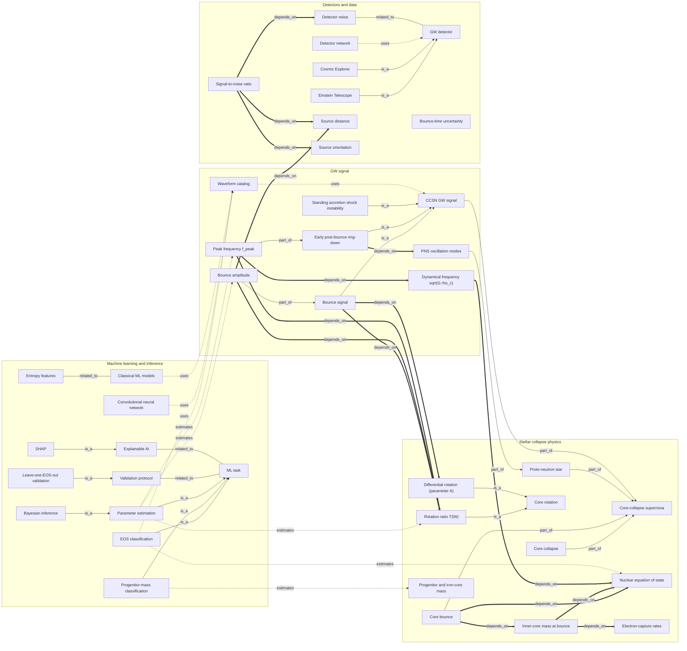

# Concept graph

Generated from `ontology/concepts.yaml` by `python3 src/ontology.py graph` (41 concepts, 49 relations). Do not edit by hand.

Arrows: `-->` is_a / part_of, `==>` depends_on, `-.->` estimates / uses, `---` related_to.

